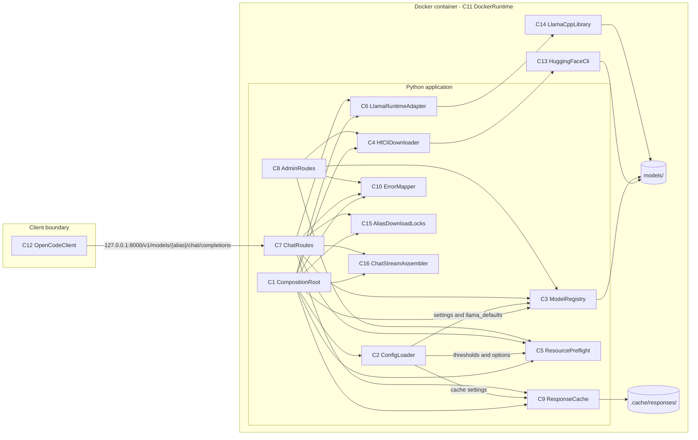
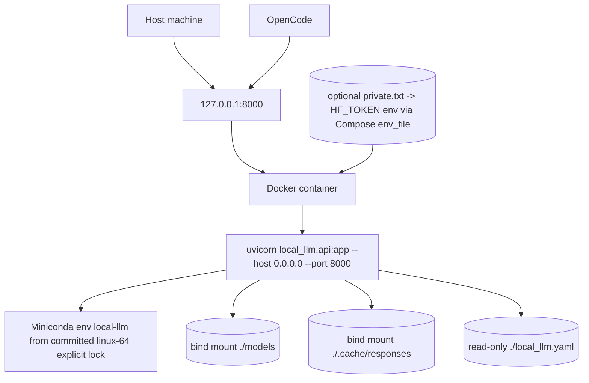
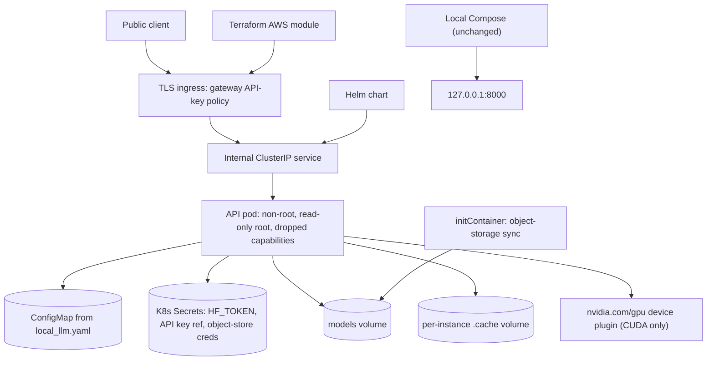

# Architecture

Status: **implemented and verified system architecture**. This document describes the component boundaries for the local LLM API. All application components are implemented, including the production ASGI entry point. The external boundaries (C13 Hugging Face CLI and C14 llama.cpp CPU inference) were exercised with real public model weights during MVP verification and again in the three-prompt OpenCode end-to-end smoke.

Authoritative scope: `docs/requirements.md`. Runtime settings: `local_llm.yaml`. Operating rules: `AGENTS.md`.

## Component count

There are **16 modeled components**:

- **12 application components** that live in the Python service.
- **4 boundary components** that are external systems or container/client configuration.

| ID | Component | Kind | Status | Responsibility |
| --- | --- | --- | --- | --- |
| C1 | CompositionRoot | Application | Implemented | Constructs concrete settings, clients, stores, clocks, and runtimes; owns startup wiring. |
| C2 | ConfigLoader | Application | Implemented | Reads `local_llm.yaml`, validates fields, merges defaults, and produces immutable settings. |
| C3 | ModelRegistry | Application | Implemented | Tracks aliases, repo IDs, filenames, revisions, options, and registered/downloaded state. |
| C4 | HfCliDownloader | Application | Implemented | Invokes the configured Hugging Face CLI (`hf` by default), writes into `models/<alias>/`, and verifies the GGUF file. |
| C5 | ResourcePreflight | Application | Implemented | Checks disk and memory estimates and fails closed before download or load. |
| C6 | LlamaRuntimeAdapter | Application | Implemented | Loads a GGUF with merged llama options, generates completions, and holds at most one resident instance until the idle-unload timer expires or an immediate-unload condition (alias switch, explicit admin unload, error) fires. |
| C7 | ChatRoutes | Application | Implemented | Exposes `/health`, `/v1/models`, and `/v1/models/{alias}/chat/completions`; resets the idle timer on a prompt or cache hit for the resident alias, and unloads it before loading a different alias. |
| C8 | AdminRoutes | Application | Implemented | Exposes runtime add, unload, and remove operations. |
| C9 | ResponseCache | Application | Implemented | Stores completed responses, keys full normalized requests, evicts by TTL/size, and replays SSE. |
| C10 | ErrorMapper | Application | Implemented | Converts config, download, preflight, runtime, and validation failures into stable HTTP errors. |
| C11 | DockerRuntime | Boundary | Implemented as files | Builds and runs the Miniconda image, optionally injects `HF_TOKEN` from `private.txt` via Compose `env_file`, and publishes the container port only on host loopback. |
| C12 | OpenCodeClient | Boundary | Implemented as config | Calls each alias-specific OpenAI-compatible endpoint using `limit` and `body.options`. |
| C13 | HuggingFaceCli | Boundary | External | Performs public model downloads inside the container. |
| C14 | LlamaCppLibrary | Boundary | External dependency | Provides `Llama(...)`, `create_chat_completion`, and streaming generation on CPU. |
| C15 | AliasDownloadLocks | Application | Implemented | Provides per-alias download locks so slow download I/O stays outside the lifecycle lock without duplicate same-alias downloads. |
| C16 | ChatStreamAssembler | Application | Implemented | Frames live OpenAI-compatible chunks as SSE and assembles one completed response for caching after successful stream exhaustion. |

## UML component view



## UML class view


## How the components do their work

| Component | Input | Work | Output | Failure behavior |
| --- | --- | --- | --- | --- |
| C1 CompositionRoot | Settings from C2 | Constructs all concrete components and injects collaborators. | Running FastAPI app. | Startup aborts with a named configuration error. |
| C2 ConfigLoader | `local_llm.yaml`, env overrides | Validates aliases, repo IDs, `.gguf` filenames, llama options, cache settings, and thresholds. | Immutable settings. | Raises validation error naming the offending field. |
| C3 ModelRegistry | Configured or runtime-added model records | Stores alias-to-model mappings and lifecycle state. | Model records for routes and runtime. | Duplicate or unknown aliases are rejected. |
| C4 HfCliDownloader | Model record and destination | Runs the configured Hugging Face CLI (`hf` by default) inside the container and verifies the file. | Local GGUF path. | Returns sanitized download error; writes no partial model path on rejected requests. |
| C5 ResourcePreflight | Disk/RAM thresholds and model path | Estimates required disk before download and memory before load. | Approval to proceed. | Fails closed with `503` and does not download or load. |
| C6 LlamaRuntimeAdapter | GGUF path, merged llama and sampling options, chat request | Calls `Llama(...)`, generates either a completed response (`stream=False`) or native chunks (`stream=True`) using merged sampling options, then keeps at most one resident instance until the idle-unload timer expires or an immediate-unload condition fires. | OpenAI-compatible response or native chunk iterator. | Runtime or cache-put errors unload immediately and cancel the timer; runtime failures map to sanitized `502`/`504`. |
| C7 ChatRoutes | OpenAI-compatible request body | Checks cache first; on miss, coordinates preflight, registry, runtime, cache write, and idle-unload scheduling; refreshes the timer on a prompt or cache hit for the resident alias and unloads before loading a different alias. | JSON or SSE response. | Invalid bodies return `422` through C10. |
| C8 AdminRoutes | Add/unload/remove requests | Registers new models, unloads current instances (cancelling the idle timer), and removes aliases. | Updated registry state. | Invalid aliases or failed downloads return stable errors. |
| C9 ResponseCache | Cache key and completed response | Hashes canonical request data, writes atomically, expires and evicts entries, replays SSE. | Cached response or cache miss. | Corrupt or expired entries are deleted and treated as misses. |
| C10 ErrorMapper | Domain and runtime exceptions | Converts exceptions to stable HTTP status codes and sanitized envelopes. | HTTP error response. | Preserves safe cause metadata without leaking paths or stack traces. |
| C16 ChatStreamAssembler | Native OpenAI-shaped chunk mappings | Emits each chunk as `data: <json>\n\n` and accumulates choice deltas into one `chat.completion` response. | Live SSE frames and a completed response for C9. | Empty streams fail; incomplete responses are never cached. Usage is included only when supplied by runtime chunks. |
| C11 DockerRuntime | Dockerfile, Compose file, `environment.yaml`, `environment-linux-64.lock`, volumes, optional `private.txt` | Builds a digest-pinned Miniconda image from the committed linux-64 SHA-256 explicit lock, optionally injects `HF_TOKEN` into `api`/`tests`/`dev`, mounts `models/` and `.cache/`, and publishes only host loopback. | Reproducible containerized test/dev/API environments. | Invalid Compose config or a stale/invalid lock fails before deployment; a missing `private.txt` no longer blocks public-model operation. |
| C12 OpenCodeClient | `opencode.jsonc` providers | Sends chat requests to alias-specific base URLs with `limit` and `body.options`. | Selectable local models. | Missing server appears as provider/model unavailable. |
| C13 HuggingFaceCli | Public repo ID, filename, revision | Downloads exact GGUF file to `models/<alias>/`. | Files on mounted volume. | Auth, gated, or network failures propagate to C4. |
| C14 LlamaCppLibrary | GGUF path and llama options | Performs CPU inference and streaming generation. | Completion chunks or full response. | Load or generation errors propagate to C6. |

## UML sequence: cache hit

```mermaid
sequenceDiagram
    participant OC as C12 OpenCodeClient
    participant CHAT as C7 ChatRoutes
    participant CACHE as C9 ResponseCache

    OC->>CHAT: POST /v1/models/{alias}/chat/completions
    CHAT->>CHAT: build normalized cache key
    CHAT->>CACHE: get(key)
    CACHE-->>CHAT: cached response
    CHAT->>CACHE: replay_sse(response) if stream:true
    CACHE-->>OC: SSE frames + [DONE]
    Note over CHAT,CACHE: Cache hits skip load preflight, model loading, and inference after GGUF path/fingerprint resolution; if GGUF is absent, download restoration and its fail-closed preflight still occur before key computation. A cache hit also refreshes the idle-unload timer when a model instance is resident.
```

## UML sequence: cache miss with model load and idle unload

```mermaid
sequenceDiagram
    participant OC as C12 OpenCodeClient
    participant CHAT as C7 ChatRoutes
    participant CACHE as C9 ResponseCache
    participant PRE as C5 ResourcePreflight
    participant REG as C3 ModelRegistry
    participant RT as C6 LlamaRuntimeAdapter
    participant LLAMA as C14 LlamaCppLibrary

    OC->>CHAT: POST /v1/models/{alias}/chat/completions
    CHAT->>CACHE: get(key)
    CACHE-->>CHAT: null
    alt requested alias already resident
        CHAT->>RT: reuse instance (skip load preflight)
    else different alias resident or none resident
        CHAT->>RT: unload() resident immediately if a different alias is loaded
        CHAT->>PRE: checkLoad(model_path)
        PRE-->>CHAT: ok
        CHAT->>REG: get(alias)
        REG-->>CHAT: model record
        CHAT->>RT: load(path, merged options)
        RT->>LLAMA: Llama(n_ctx, n_batch, flash_attn, ...)
    end
    CHAT->>RT: chat(request)
    RT-->>CHAT: completed response
    CHAT->>CACHE: put(key, alias, revision, response)
    CHAT->>RT: start/reset idle timer for resident alias (no unload)
    CHAT-->>OC: JSON or SSE response
    Note over CHAT,RT: The idle timer uses the process-wide lock (server.lock_timeout_seconds: 600). After server.idle_unload_seconds (default 180 s; valid > 0 and <= 86400 s / 24 h) with no prompt for the loaded alias, the instance is unloaded; a prompt for a different alias unloads it immediately before loading the new alias; explicit admin unload or a runtime/cache-put error unloads immediately and cancels the timer. Only one instance exists at a time; OpenCode's 96-token cap is unchanged.
```

For a `stream: true` cache miss, C7 acquires the lifecycle lock before returning the response, performs the cache double-check and load/reuse setup, and obtains the native iterator from C6. C16 forwards each chunk immediately as SSE while assembling the completed response. C9 is written only after successful exhaustion; the lock is released after `[DONE]`, an error, or early close. Errors after streaming starts close the native iterator before immediate unload and emit C10's sanitized body as an SSE `error` event without `[DONE]`; client disconnect performs cleanup without an error frame. Cache hits continue to use C9 replay.

## UML state: model lifecycle

```mermaid
stateDiagram-v2
    %% server.idle_unload_seconds: default 180 s; valid > 0 and <= 86400 s (24 h)
    [*] --> Registered
    Registered --> Downloaded: startup or admin add
    Downloaded --> Unloaded: ready
    Unloaded --> Loading: first endpoint call (load preflight)
    Loading --> Loaded: Llama created
    Loaded --> Generating: chat request
    Generating --> Loaded: response complete or [DONE]; start/reset idle timer
    Loaded --> Loaded: prompt or cache hit for resident alias resets idle timer
    Loaded --> Unloaded: idle timer expires (server.idle_unload_seconds)
    Loaded --> Unloaded: different-alias prompt (unload before loading new alias)
    Loaded --> Unloaded: explicit admin unload (cancel timer)
    Generating --> Failed: runtime or cache-put error
    Failed --> Unloaded: immediate unload; cancel timer
    Registered --> Removed: admin remove
    Downloaded --> Removed: admin remove
    Unloaded --> Removed: admin remove
    Removed --> [*]
```



## UML deployment view



## Phase 2 Kubernetes deployment view

`DECISION-26` is implemented in the Phase 2 branch. The MVP deployment above remains the local loopback topology; the diagram below is the committed cloud topology for `AC-81`–`AC-167`.



Implemented boundaries: public ingress exposes only `/health` and per-alias chat completions; `/v1/models` and `/admin/models*` stay internal; NetworkPolicy denies direct pod access. The application has no auth, no secrets-manager client, and no object-storage client in its own request path. Backend selection inserts `compute.backend_defaults` between `llama_defaults` and model/request options, and `compute.fallback: fail_closed` prevents silent CUDA-to-CPU degradation. The selected CPU or CUDA flavor digest is referenced by Compose metadata, Helm, and Terraform; weights and cache remain volumes and are never image layers. Apple Metal is documentation-only, not a Linux container or cloud target.

## Dependency rules

- `CompositionRoot` is the only component that constructs concrete implementations.
- HTTP routes depend on application contracts, not on `llama_cpp` or filesystem details.
- I/O, clocks, randomness, subprocess calls, and retries stay at explicit edges.
- Cache hits skip load preflight, model loading, and inference after GGUF path/fingerprint resolution; if the GGUF file is absent, download restoration and its fail-closed preflight still occur before key computation.
- Download I/O never runs under the process-wide lifecycle lock. C15 serializes downloads per alias; C7 re-acquires the lifecycle lock only for short existence re-checks and registry mutation. C1 runs startup downloads concurrently up to `download.max_parallel_downloads` only after fail-closed preflight checks.
- A streaming cache miss uses native llama.cpp chunks; a streaming cache hit uses C9 replay. C16 assembles one completed response for C9 only after successful exhaustion. The lifecycle lock covers the entire live stream; pre-response errors retain normal HTTP envelopes, while later errors use sanitized SSE error events. Partial responses are never cached.
- At most one model instance is resident at a time. A prompt for a different alias unloads the current instance immediately before loading the new one; load preflight is skipped when reusing the already loaded alias and still runs on a cold load and on download restoration.
- The idle-unload timer uses the same process-wide lock as generation (`server.lock_timeout_seconds: 600`; contention remains `503`). A prompt for the loaded alias or a cache hit resets the timer; explicit admin unload and runtime/cache-put errors unload immediately and cancel it. `server.idle_unload_seconds` defaults to `180` and is validated `> 0` and `<= 86400` (24 hours).
- OpenCode's 96-token cap (`limit.output` and `body.options.max_tokens`) is unchanged by idle retention.
- `ModelRegistry.list()` is the external model-list contract and returns `ModelRecord`s only; `get()` is internal and may return `RegistryEntry.path` for runtime loading. External routes must not serialize that path.
- Cache keys include request `options`; changing `n_ctx`, `n_batch`, `flash_attn`, `temperature`, `top_p`, `top_k`, `min_p`, or `repeat_penalty` produces a different key.
- `make_cache_key` receives a validated alias from the registry and a fingerprint from `weight_fingerprint`; both are non-empty by contract and are not re-checked inside the cache.
- No component reads host Python or host conda state.
- `HF_TOKEN` is optionally injected by C11 from `private.txt` into the container environment; without it, C4 downloads public GGUFs unauthenticated. C4/C13 never receive the token as a CLI argument and no component logs its value.
- All persistent state is through the two mounted volumes and the read-only config file.

## Security boundary and top-seven plan

The baseline for this plan was pushed to `origin/main` as `3d7e43a` before any planning or implementation work. Tech Lead, Delivery Manager, and Security Engineer reviews converge on one decision: items 1–7 already exist, so this pass preserves their contracts and hardens the documentation/verification boundary instead of changing runtime behavior.

| Concern | Preserved component contract | Mitigation in this plan | Residual / decision |
|---|---|---|---|
| Unauthenticated local chat and admin routes | C7/C8 route contracts; C11 publishes only host `127.0.0.1:8000` | Loopback is the trust boundary; do not publish `0.0.0.0` on the host; keep stable `422`/`502`/`503` envelopes | Any local host process is trusted; auth, rate limiting, and approved-alias gating are deferred under `ASSUMPTION-17` |
| Plaintext response data at rest | C9 writes one completed-response JSON per cache key under `.cache/responses/` | Document response-text sensitivity, 30-day TTL, 1 GiB cap, and filesystem access restriction; do not put secrets in prompts | Encryption and shorter TTL are deferred; prompt text participates in the SHA-256 key but is not stored verbatim |
| Cache staleness after a same-size GGUF swap | C9 fingerprint is `size:mtime_ns` from C3/C6 | Keep alias/revision and fingerprint in the key; document immutable-weight assumption | Content hash/versioned alias is deferred |
| Local disk exhaustion from synchronous admin downloads | C8 `POST /admin/models`, C4 downloader, C5 disk preflight | Prefer startup-configured models; keep configured download timeout and disk fail-closed preflight | Async queue and admin gating are deferred |
| Token exposure through Compose output or logs | C11 optionally injects `HF_TOKEN` from `private.txt`; C4 uses `hf` without token CLI arguments | Keep optional `env_file`, gitignore/dockerignore, and mandate `--no-interpolate` when sharing config | Plain `docker compose config` still prints the resolved token when configured; operational discipline remains required |
| Root container process | C11 Dockerfile/Compose boundary | No runtime behavior change in this pass; keep read-only config mounts and no host runtime dependencies | Non-root `USER` is deferred pending Windows bind-mount ownership verification under `ASSUMPTION-17` |
| Lock contention / head-of-line blocking and idle model retention | C6/C7 process-wide lock; `server.lock_timeout_seconds: 600`; `503` on contention; at most one resident GGUF, kept for `server.idle_unload_seconds` (default 180 s, validated `> 0` and `<= 86400` s / 24 h) after the last prompt | Document the wait and stable error; the idle timer uses the same lock; a resident GGUF stays in container memory after the response but is not a response cache; admin unload cancels the timer; keep OpenCode 96-token cap | A resident model holds RAM between prompts; concurrent generation and concurrent multi-model residency are deferred |

## Verified and unverified

- Verified: `docker compose config` and `docker compose --profile serve config --no-interpolate` parse successfully with the provided Docker Compose binary. The no-interpolate form confirms the API command `uvicorn local_llm.api:app --host 0.0.0.0 --port 8000`, loopback-only host publishing (`host_ip: 127.0.0.1`, `published: "8000"`, `target: 8000`), optional `env_file` wiring (`required: false`) for `api`/`tests`/`dev`, a read-only config mount, and local model/cache mounts without printing `HF_TOKEN`.
- Verified: the production ASGI entry point `local_llm.api:app` is exposed as `app = build_app()` in `local_llm/api.py`; `local_llm/composition.py` uses FastAPI lifespan startup wiring and no deprecated `on_event` hook.
- Verified: the Miniconda test image builds and the current `docker compose run --rm tests` passes all 142 response-cache, config-loader, model-registry, Hugging Face CLI downloader, resource-preflight, runtime, streaming-assembly, error-mapping, chat-route, admin-route, composition, dependency-lock, OpenCode-config, and container-environment tests, including idle retention, native streaming, optional-token boundaries, reproducible-build checks, and capture of the model output for `what is your name, respond using minimal tokens?`.
- Verified: `docker compose --profile serve up -d api` started the API container with placeholder GGUF files; `/health` returned `{"status":"ok"}` from inside the container and logs showed per-model download-skip status.
- Verified: `git check-ignore -v private.txt models/ .cache/responses/` reports `.gitignore:5:private.txt`, `.gitignore:2:models/`, and `.gitignore:3:.cache/`; `.dockerignore` also excludes `private.txt` from the image build context.
- Superseded: earlier host-conda cache test results and the Docker daemon HTTP 500 failure are no longer the latest evidence.
- Verified: a token-authenticated real-model smoke test passed inside Docker with `Qwen/Qwen2.5-Coder-0.5B-Instruct-GGUF` (alias `qwen25-coder-05b`). The API container reported `HF_TOKEN configured: True` and `hf download` restored the GGUF without the unauthenticated warning. From host loopback, `/health`, `/v1/models`, and the chat endpoint returned `200`; the prompt `what is your name, respond using minimal tokens?` produced `I am Qwen.`. A repeat replayed the cached response, admin unload returned `200`, admin delete returned `204`, and weights/cache entries were removed afterward.
- Verified for this change: `DECISION-21` idle retention (`server.idle_unload_seconds` default 180 s, validated `> 0` and `<= 86400` s / 24 h) and its observable criteria `AC-57`–`AC-61` — timer reset on a prompt or cache hit, immediate unload on alias switch / explicit admin unload / runtime or cache-put error, preflight skipped when reusing the loaded alias, and a single resident instance. The idle timer shares the process-wide lock (`server.lock_timeout_seconds: 600`); the OpenCode 96-token cap is unchanged. The final Docker run passed 110 tests, and the three-prompt OpenCode end-to-end smoke confirmed inputs and outputs from the local provider.
- Contract tests use a fake Hugging Face CLI and a fake Llama runtime. Cache-hit SSE replay reconstructs frames from stored complete responses; cache-miss streaming uses native incremental llama.cpp chunks under `DECISION-23`.
- Verified for this change: `DECISION-24` optional `HF_TOKEN` (`AC-73`–`AC-76`). Compose config and the then-current 136 Docker tests passed with `private.txt` present and absent; the current 142-test `DECISION-25` suite was re-run in both token states and passed. A no-token real-model smoke downloaded the public Qwen GGUF with `HF_TOKEN` absent in dev and API containers, reached `/health`, and returned `I am Qwen.` Loopback publish, `public_only`, fail-closed preflight, token hygiene, and the OpenCode 96-token cap are unchanged.
- Verified for this change: `DECISION-25` reproducible dependencies (`AC-77`–`AC-80`). `docker buildx imagetools inspect` identified the digest-pinned base as `linux/amd64`; a clean no-cache amd64 image build installed only from the committed linux-64 SHA-256 lock; the regenerated lock matched byte-for-byte; all 142 Docker tests pass; Compose config remains loopback-only with optional token injection. No application module, route contract, runtime behavior, or `ASSUMPTION-17` decision changed.
- Implemented: `DECISION-26` Phase 2 (`AC-81`–`AC-167`) adds Kubernetes, gateway API-key ingress, CUDA/CPU backend selection, object-storage sync, K8s Secrets, non-root/read-only cloud pods, Helm, and an AWS Terraform reference module. Docker-verifiable phases pass in the expanded 174-test suite; Helm lint/template/client dry-run and Terraform init/validate/format also run inside Docker; live cluster/Gateway/TLS and AWS plan execution remain platform gates documented in `docs/deployment.md`.
- No application components are pending for MVP. C13 and C14 are external boundaries; `ASSUMPTION-16` is implemented by `DECISION-25` as a linux-64-only explicit dependency lock, with multi-architecture locks deferred and non-MVP.

## Closed implementation assumptions

The tech lead closed `ASSUMPTION-1` through `ASSUMPTION-16`. Closing a decision does not change component status; the "Component count" table remains the only status source of truth.

| ID | Closed decision | Component(s) |
| --- | --- | --- |
| `ASSUMPTION-1` | Config is repo-root `local_llm.yaml`; `LOCAL_LLM_CONFIG` overrides, explicit path wins. Alias `^[a-z0-9_-]+$`; `repo_id` is `owner/name`; `filename` is a `.gguf` basename; duplicate aliases rejected. | C2 |
| `ASSUMPTION-2` | Container binds `0.0.0.0:8000`; Compose publishes only host `127.0.0.1:8000`. | C11 |
| `ASSUMPTION-3` | `POST /admin/models`, `POST /admin/models/{alias}/unload`, `DELETE /admin/models/{alias}`. `DELETE` unregisters only: `204` success, `404` unknown; `unload` is a no-op when not loaded. | C8 |
| `ASSUMPTION-4` | Disk free `>= min_free_disk_gb + reserve_disk_gb`. RAM estimate is GGUF file size; available RAM from `/proc/meminfo` `MemAvailable` with `os.sysconf` fallback; read failure fails closed. | C5 |
| `ASSUMPTION-5` | No auth in MVP; loopback-only host publish is the control. | C11 boundary; C7/C8 |
| `ASSUMPTION-6` | `{command} download {repo_id} {filename} --revision {revision} --local-dir models/<alias>`, with `command: hf` by default. Public check before download; runner and repo-info injected; skip non-empty existing file. | C4 |
| `ASSUMPTION-7` | One process-wide lock, configurable `server.lock_timeout_seconds` (default 600 s), `503` on contention; the idle-unload timer uses this same lock. | C7 / C6 |
| `ASSUMPTION-8` | Cache `put` after full response assembly; no cache on error. With `DECISION-21`, a successful non-streaming or streaming response starts/resets the idle-unload timer instead of unloading at completion/`[DONE]`; a runtime or cache-put error unloads immediately and cancels the timer. | C6 / C7 / C9 |
| `ASSUMPTION-9` | Runtime aliases are ephemeral; server never rewrites `local_llm.yaml`. | C8 |
| `ASSUMPTION-10` | One OpenCode provider per alias. | C12 |
| `ASSUMPTION-11` | Cache key is SHA-256 of `canonical_json`; fingerprint `size:mtime_ns`; exclude `stream`, `stream_options`, `request_id`, `verbose`. | C9 |
| `ASSUMPTION-12` | Cache defaults `ttl_days: 30`, `max_size_mb: 1024`. | C9 / `local_llm.yaml` |
| `ASSUMPTION-13` | SSE replay reconstructs frames from the stored complete response; raw chunk bytes are not stored. | C9 |
| `ASSUMPTION-14` | `flash_attn` is passed as configured; runtime rejection maps to a sanitized `502`. | C6 / C10 |
| `ASSUMPTION-15` | Chat accepts OpenAI fields plus `options`. Load merge: `llama_defaults` → model `options` → request `options`. Sampling merge: `generation_defaults` → model `options` sampling keys → request top-level fields → request `options` sampling keys. | C6 / C7 |
| `ASSUMPTION-16` | A linux-64 explicit lock generated inside Docker is committed; the Dockerfile digest-pins the base and installs from the lock. `environment.yaml` stays the source of truth; multi-arch locks are deferred. | C11 boundary (implemented by `DECISION-25`) |

## Open decision for the top-seven plan

| ID | Open assumption | Owner | Required decision |
| --- | --- | --- | --- |
| `ASSUMPTION-17` | Loopback-only exposure, token hygiene, cache-retention guidance, and Docker-only execution are sufficient cybersecurity mitigations for a trusted single-user host. | Product Lead + Security Engineer | **Still open.** `DECISION-26` records Phase 2 gateway API-key auth and cloud non-root/read-only as explicit product choices, but rate limiting, cache encryption, application-level auth, and local Compose non-root remain undecided. Confirm the local host is trusted; do not treat the Phase 2 plan as closure of this assumption. |

