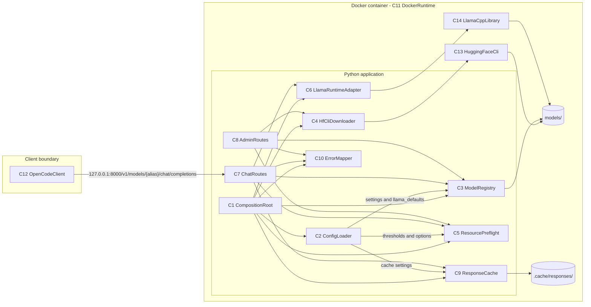
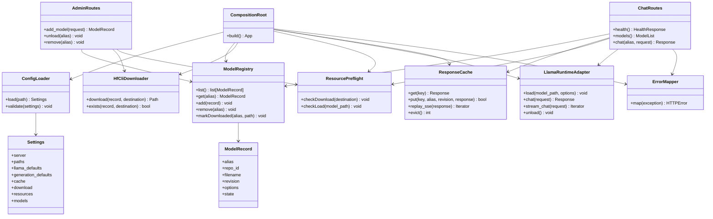
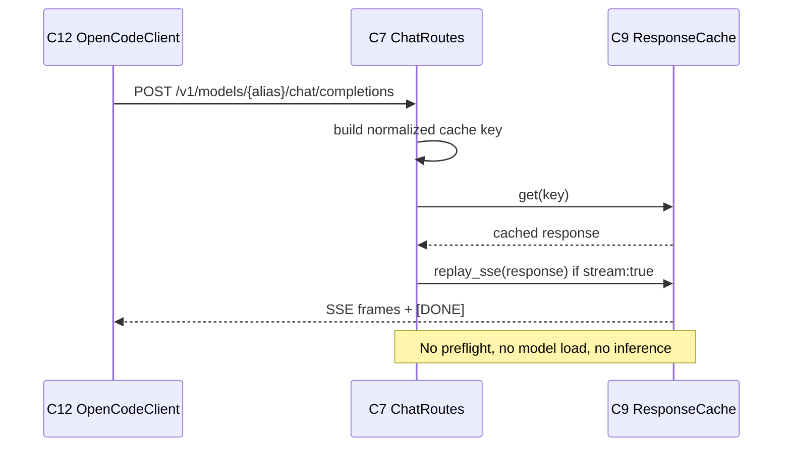
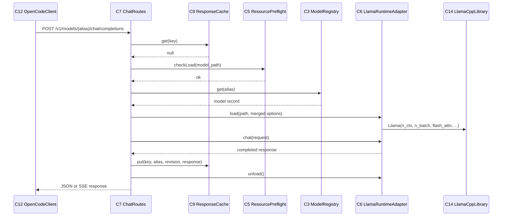
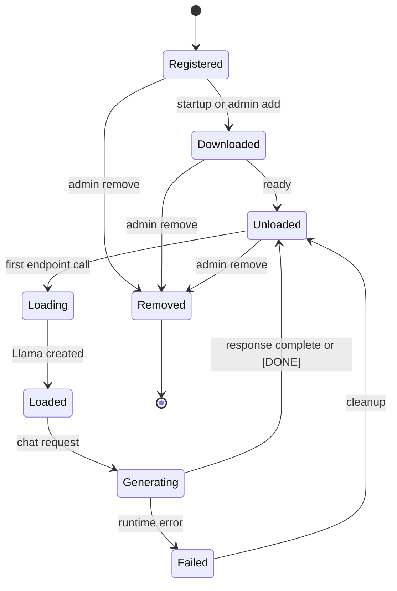
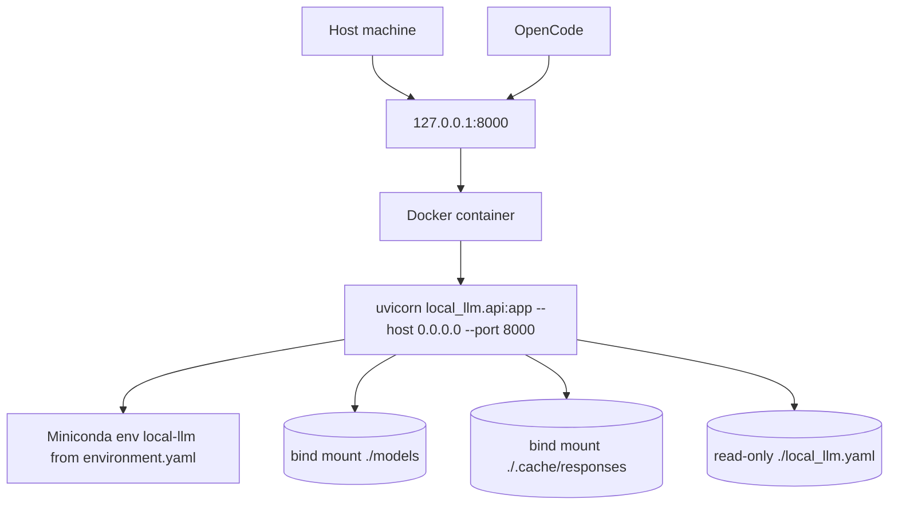

# Architecture

Status: **planned system architecture with implemented pieces marked**. This document describes the intended component boundaries for the local LLM API. It does not claim the full API is implemented.

Authoritative scope: `docs/requirements.md`. Runtime settings: `local_llm.yaml`. Operating rules: `AGENTS.md`.

## Component count

There are **14 modeled components**:

- **10 application components** that will live in the Python service.
- **4 boundary components** that are external systems or container/client configuration.

| ID | Component | Kind | Status | Responsibility |
| --- | --- | --- | --- | --- |
| C1 | CompositionRoot | Application | Planned | Constructs concrete settings, clients, stores, clocks, and runtimes; owns startup wiring. |
| C2 | ConfigLoader | Application | Planned | Reads `local_llm.yaml`, validates fields, merges defaults, and produces immutable settings. |
| C3 | ModelRegistry | Application | Planned | Tracks aliases, repo IDs, filenames, revisions, options, and registered/downloaded state. |
| C4 | HfCliDownloader | Application | Planned | Invokes `huggingface-cli download`, writes into `models/<alias>/`, and verifies the GGUF file. |
| C5 | ResourcePreflight | Application | Planned | Checks disk and memory estimates and fails closed before download or load. |
| C6 | LlamaRuntimeAdapter | Application | Planned | Loads a GGUF with merged llama options, generates completions, and unloads after response. |
| C7 | ChatRoutes | Application | Planned | Exposes `/health`, `/v1/models`, and `/v1/models/{alias}/chat/completions`. |
| C8 | AdminRoutes | Application | Planned | Exposes runtime add, unload, and remove operations. |
| C9 | ResponseCache | Application | Implemented | Stores completed responses, keys full normalized requests, evicts by TTL/size, and replays SSE. |
| C10 | ErrorMapper | Application | Planned | Converts config, download, preflight, runtime, and validation failures into stable HTTP errors. |
| C11 | DockerRuntime | Boundary | Implemented as files | Builds and runs the Miniconda image; publishes container port only on host loopback. |
| C12 | OpenCodeClient | Boundary | Implemented as config | Calls each alias-specific OpenAI-compatible endpoint using `limit` and `body.options`. |
| C13 | HuggingFaceCli | Boundary | External | Performs public model downloads inside the container. |
| C14 | LlamaCppLibrary | Boundary | External dependency | Provides `Llama(...)`, `create_chat_completion`, and streaming generation on CPU. |

## UML component view

## UML class view

## How the components do their work

| Component | Input | Work | Output | Failure behavior |
| --- | --- | --- | --- | --- |
| C1 CompositionRoot | Settings from C2 | Constructs all concrete components and injects collaborators. | Running FastAPI app. | Startup aborts with a named configuration error. |
| C2 ConfigLoader | `local_llm.yaml`, env overrides | Validates aliases, repo IDs, `.gguf` filenames, llama options, cache settings, and thresholds. | Immutable settings. | Raises validation error naming the offending field. |
| C3 ModelRegistry | Configured or runtime-added model records | Stores alias-to-model mappings and lifecycle state. | Model records for routes and runtime. | Duplicate or unknown aliases are rejected. |
| C4 HfCliDownloader | Model record and destination | Runs `huggingface-cli download` inside the container and verifies the file. | Local GGUF path. | Returns sanitized download error; writes no partial model path on rejected requests. |
| C5 ResourcePreflight | Disk/RAM thresholds and model path | Estimates required disk before download and memory before load. | Approval to proceed. | Fails closed with `503` and does not download or load. |
| C6 LlamaRuntimeAdapter | GGUF path, merged llama and sampling options, chat request | Calls `Llama(...)`, generates a response using merged `temperature`, `top_p`, `top_k`, `min_p`, and `repeat_penalty`, then unloads after completion. | OpenAI-compatible response or SSE stream. | Runtime failures are mapped to sanitized `502`/`504`. |
| C7 ChatRoutes | OpenAI-compatible request body | Checks cache first; on miss, coordinates preflight, registry, runtime, cache write, and unload. | JSON or SSE response. | Invalid bodies return `422` through C10. |
| C8 AdminRoutes | Add/unload/remove requests | Registers new models, unloads current instances, and removes aliases. | Updated registry state. | Invalid aliases or failed downloads return stable errors. |
| C9 ResponseCache | Cache key and completed response | Hashes canonical request data, writes atomically, expires and evicts entries, replays SSE. | Cached response or cache miss. | Corrupt or expired entries are deleted and treated as misses. |
| C10 ErrorMapper | Domain and runtime exceptions | Converts exceptions to stable HTTP status codes and sanitized envelopes. | HTTP error response. | Preserves safe cause metadata without leaking paths or stack traces. |
| C11 DockerRuntime | Dockerfile, Compose file, volumes | Builds Miniconda image, mounts `models/` and `.cache/`, publishes only host loopback. | Containerized test/dev/API environments. | Invalid Compose config fails before deployment. |
| C12 OpenCodeClient | `opencode.jsonc` providers | Sends chat requests to alias-specific base URLs with `limit` and `body.options`. | Selectable local models. | Missing server appears as provider/model unavailable. |
| C13 HuggingFaceCli | Public repo ID, filename, revision | Downloads exact GGUF file to `models/<alias>/`. | Files on mounted volume. | Auth, gated, or network failures propagate to C4. |
| C14 LlamaCppLibrary | GGUF path and llama options | Performs CPU inference and streaming generation. | Completion chunks or full response. | Load or generation errors propagate to C6. |

## UML sequence: cache hit

## UML sequence: cache miss with model load and unload

## UML state: model lifecycle

## UML deployment view

## Dependency rules

- `CompositionRoot` is the only component that constructs concrete implementations.
- HTTP routes depend on application contracts, not on `llama_cpp` or filesystem details.
- I/O, clocks, randomness, subprocess calls, and retries stay at explicit edges.
- Response cache lookup happens before preflight and runtime load.
- Cache keys include request `options`; changing `n_ctx`, `n_batch`, `flash_attn`, `temperature`, `top_p`, `top_k`, `min_p`, or `repeat_penalty` produces a different key.
- `make_cache_key` receives a validated alias from the registry and a fingerprint from `weight_fingerprint`; both are non-empty by contract and are not re-checked inside the cache.
- No component reads host Python or host conda state.
- All persistent state is through the two mounted volumes and the read-only config file.

## Verified and unverified

- Verified: `docker compose config` and `docker compose --profile serve config` parse successfully with the provided Docker Compose binary.
- Verified: the Miniconda test image builds and `docker compose run --rm tests` passes all 9 response-cache tests (`Ran 9 tests ... OK`).
- Superseded: earlier host-conda cache test results and the Docker daemon HTTP 500 failure are no longer the latest evidence.
- Pending: API scaffold and integration of C1–C8 and C10 into the containerized service.
