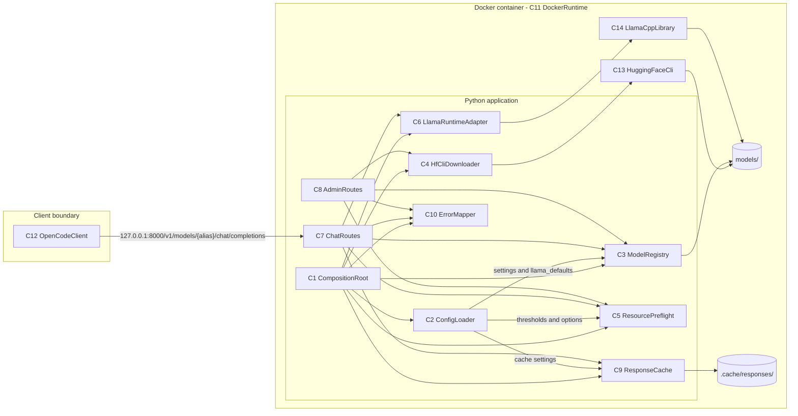
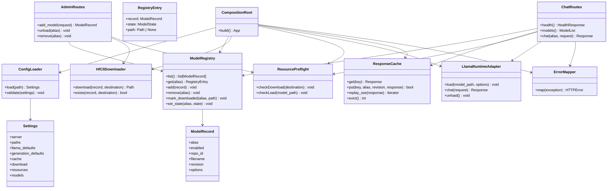
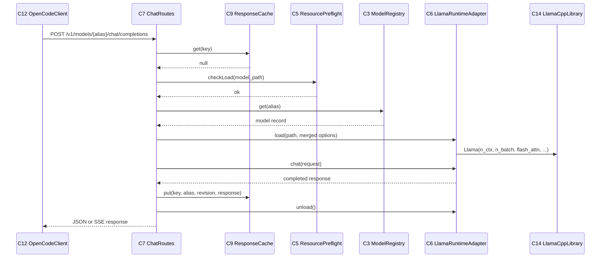
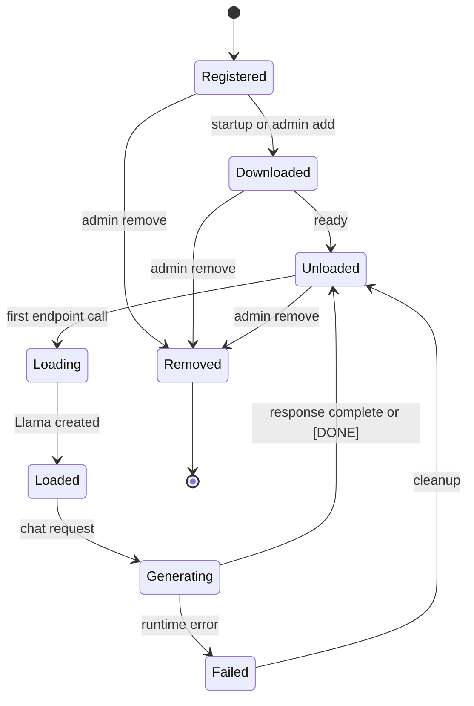
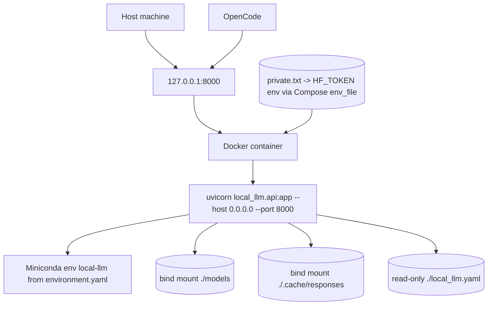

# Architecture

Status: **implemented system architecture; external boundaries unverified against real services**. This document describes the component boundaries for the local LLM API. All application components are implemented, including the production ASGI entry point. The external boundaries (C13 Hugging Face CLI and C14 llama.cpp CPU inference) have not been exercised with real public model weights during MVP verification.

Authoritative scope: `docs/requirements.md`. Runtime settings: `local_llm.yaml`. Operating rules: `AGENTS.md`.

## Component count

There are **14 modeled components**:

- **10 application components** that live in the Python service.
- **4 boundary components** that are external systems or container/client configuration.

| ID | Component | Kind | Status | Responsibility |
| --- | --- | --- | --- | --- |
| C1 | CompositionRoot | Application | Implemented | Constructs concrete settings, clients, stores, clocks, and runtimes; owns startup wiring. |
| C2 | ConfigLoader | Application | Implemented | Reads `local_llm.yaml`, validates fields, merges defaults, and produces immutable settings. |
| C3 | ModelRegistry | Application | Implemented | Tracks aliases, repo IDs, filenames, revisions, options, and registered/downloaded state. |
| C4 | HfCliDownloader | Application | Implemented | Invokes the configured Hugging Face CLI (`hf` by default), writes into `models/<alias>/`, and verifies the GGUF file. |
| C5 | ResourcePreflight | Application | Implemented | Checks disk and memory estimates and fails closed before download or load. |
| C6 | LlamaRuntimeAdapter | Application | Implemented | Loads a GGUF with merged llama options, generates completions, and unloads after response. |
| C7 | ChatRoutes | Application | Implemented | Exposes `/health`, `/v1/models`, and `/v1/models/{alias}/chat/completions`. |
| C8 | AdminRoutes | Application | Implemented | Exposes runtime add, unload, and remove operations. |
| C9 | ResponseCache | Application | Implemented | Stores completed responses, keys full normalized requests, evicts by TTL/size, and replays SSE. |
| C10 | ErrorMapper | Application | Implemented | Converts config, download, preflight, runtime, and validation failures into stable HTTP errors. |
| C11 | DockerRuntime | Boundary | Implemented as files | Builds and runs the Miniconda image, injects `HF_TOKEN` from `private.txt` via Compose `env_file`, and publishes the container port only on host loopback. |
| C12 | OpenCodeClient | Boundary | Implemented as config | Calls each alias-specific OpenAI-compatible endpoint using `limit` and `body.options`. |
| C13 | HuggingFaceCli | Boundary | External | Performs public model downloads inside the container. |
| C14 | LlamaCppLibrary | Boundary | External dependency | Provides `Llama(...)`, `create_chat_completion`, and streaming generation on CPU. |

## UML component view



## UML class view



## How the components do their work

| Component | Input | Work | Output | Failure behavior |
| --- | --- | --- | --- | --- |
| C1 CompositionRoot | Settings from C2 | Constructs all concrete components and injects collaborators. | Running FastAPI app. | Startup aborts with a named configuration error. |
| C2 ConfigLoader | `local_llm.yaml`, env overrides | Validates aliases, repo IDs, `.gguf` filenames, llama options, cache settings, and thresholds. | Immutable settings. | Raises validation error naming the offending field. |
| C3 ModelRegistry | Configured or runtime-added model records | Stores alias-to-model mappings and lifecycle state. | Model records for routes and runtime. | Duplicate or unknown aliases are rejected. |
| C4 HfCliDownloader | Model record and destination | Runs the configured Hugging Face CLI (`hf` by default) inside the container and verifies the file. | Local GGUF path. | Returns sanitized download error; writes no partial model path on rejected requests. |
| C5 ResourcePreflight | Disk/RAM thresholds and model path | Estimates required disk before download and memory before load. | Approval to proceed. | Fails closed with `503` and does not download or load. |
| C6 LlamaRuntimeAdapter | GGUF path, merged llama and sampling options, chat request | Calls `Llama(...)`, generates a response using merged `temperature`, `top_p`, `top_k`, `min_p`, and `repeat_penalty`, then unloads after completion. | OpenAI-compatible response or SSE stream. | Runtime failures are mapped to sanitized `502`/`504`. |
| C7 ChatRoutes | OpenAI-compatible request body | Checks cache first; on miss, coordinates preflight, registry, runtime, cache write, and unload. | JSON or SSE response. | Invalid bodies return `422` through C10. |
| C8 AdminRoutes | Add/unload/remove requests | Registers new models, unloads current instances, and removes aliases. | Updated registry state. | Invalid aliases or failed downloads return stable errors. |
| C9 ResponseCache | Cache key and completed response | Hashes canonical request data, writes atomically, expires and evicts entries, replays SSE. | Cached response or cache miss. | Corrupt or expired entries are deleted and treated as misses. |
| C10 ErrorMapper | Domain and runtime exceptions | Converts exceptions to stable HTTP status codes and sanitized envelopes. | HTTP error response. | Preserves safe cause metadata without leaking paths or stack traces. |
| C11 DockerRuntime | Dockerfile, Compose file, volumes, `private.txt` | Builds Miniconda image, injects `HF_TOKEN` into `api`/`tests`/`dev`, mounts `models/` and `.cache/`, and publishes only host loopback. | Containerized test/dev/API environments. | Invalid Compose config or missing `private.txt` fails before deployment. |
| C12 OpenCodeClient | `opencode.jsonc` providers | Sends chat requests to alias-specific base URLs with `limit` and `body.options`. | Selectable local models. | Missing server appears as provider/model unavailable. |
| C13 HuggingFaceCli | Public repo ID, filename, revision | Downloads exact GGUF file to `models/<alias>/`. | Files on mounted volume. | Auth, gated, or network failures propagate to C4. |
| C14 LlamaCppLibrary | GGUF path and llama options | Performs CPU inference and streaming generation. | Completion chunks or full response. | Load or generation errors propagate to C6. |

## UML sequence: cache hit

```mermaid
sequenceDiagram
    participant OC as C12 OpenCodeClient
    participant CHAT as C7 ChatRoutes
    participant CACHE as C9 ResponseCache

    OC->>CHAT: POST /v1/models/{alias}/chat/completions
    CHAT->>CHAT: build normalized cache key
    CHAT->>CACHE: get(key)
    CACHE-->>CHAT: cached response
    CHAT->>CACHE: replay_sse(response) if stream:true
    CACHE-->>OC: SSE frames + [DONE]
    Note over CHAT,CACHE: Cache hits skip load preflight, model loading, and inference after GGUF path/fingerprint resolution; if GGUF is absent, download restoration and its fail-closed preflight still occur before key computation
```

## UML sequence: cache miss with model load and unload



## UML state: model lifecycle



## UML deployment view



## Dependency rules

- `CompositionRoot` is the only component that constructs concrete implementations.
- HTTP routes depend on application contracts, not on `llama_cpp` or filesystem details.
- I/O, clocks, randomness, subprocess calls, and retries stay at explicit edges.
- Cache hits skip load preflight, model loading, and inference after GGUF path/fingerprint resolution; if the GGUF file is absent, download restoration and its fail-closed preflight still occur before key computation.
- `ModelRegistry.list()` is the external model-list contract and returns `ModelRecord`s only; `get()` is internal and may return `RegistryEntry.path` for runtime loading. External routes must not serialize that path.
- Cache keys include request `options`; changing `n_ctx`, `n_batch`, `flash_attn`, `temperature`, `top_p`, `top_k`, `min_p`, or `repeat_penalty` produces a different key.
- `make_cache_key` receives a validated alias from the registry and a fingerprint from `weight_fingerprint`; both are non-empty by contract and are not re-checked inside the cache.
- No component reads host Python or host conda state.
- `HF_TOKEN` is injected by C11 from `private.txt` into the container environment; C4/C13 never receive it as a CLI argument and no component logs its value.
- All persistent state is through the two mounted volumes and the read-only config file.

## Verified and unverified

- Verified: `docker compose config` and `docker compose --profile serve config --no-interpolate` parse successfully with the provided Docker Compose binary. The no-interpolate form confirms the API command `uvicorn local_llm.api:app --host 0.0.0.0 --port 8000`, loopback-only host publishing (`host_ip: 127.0.0.1`, `published: "8000"`, `target: 8000`), `env_file` wiring for `api`/`tests`/`dev`, a read-only config mount, and local model/cache mounts without printing `HF_TOKEN`.
- Verified: the production ASGI entry point `local_llm.api:app` is exposed as `app = build_app()` in `local_llm/api.py`; `local_llm/composition.py` uses FastAPI lifespan startup wiring and no deprecated `on_event` hook.
- Verified: the Miniconda test image builds and `docker compose run --rm tests` passes all 95 response-cache, config-loader, model-registry, Hugging Face CLI downloader, resource-preflight, runtime, error-mapping, chat-route, admin-route, composition, OpenCode-config, and container-environment tests, including capture of the model output for `what is your name, respond using minimal tokens?`.
- Verified: `docker compose --profile serve up -d api` started the API container with placeholder GGUF files; `/health` returned `{"status":"ok"}` from inside the container and logs showed per-model download-skip status.
- Verified: `git check-ignore -v private.txt models/ .cache/responses/` reports `.gitignore:5:private.txt`, `.gitignore:2:models/`, and `.gitignore:3:.cache/`; `.dockerignore` also excludes `private.txt` from the image build context.
- Superseded: earlier host-conda cache test results and the Docker daemon HTTP 500 failure are no longer the latest evidence.
- Verified: a token-authenticated real-model smoke test passed inside Docker with `Qwen/Qwen2.5-Coder-0.5B-Instruct-GGUF` (alias `qwen25-coder-05b`). The API container reported `HF_TOKEN configured: True` and `hf download` restored the GGUF without the unauthenticated warning. From host loopback, `/health`, `/v1/models`, and the chat endpoint returned `200`; the prompt `what is your name, respond using minimal tokens?` produced `I am Qwen.`. A repeat replayed the cached response, admin unload returned `200`, admin delete returned `204`, and weights/cache entries were removed afterward.
- Contract tests use a fake Hugging Face CLI and a fake Llama runtime. SSE replay reconstructs frames from stored complete responses by design; it is not true incremental streaming generation.
- No application components are pending for MVP. C13 and C14 are external boundaries; `ASSUMPTION-16` (committed dependency lock file) remains deferred and non-MVP.

## Closed implementation assumptions

The tech lead closed `ASSUMPTION-1` through `ASSUMPTION-16`. Closing a decision does not change component status; the "Component count" table remains the only status source of truth.

| ID | Closed decision | Component(s) |
| --- | --- | --- |
| `ASSUMPTION-1` | Config is repo-root `local_llm.yaml`; `LOCAL_LLM_CONFIG` overrides, explicit path wins. Alias `^[a-z0-9_-]+$`; `repo_id` is `owner/name`; `filename` is a `.gguf` basename; duplicate aliases rejected. | C2 |
| `ASSUMPTION-2` | Container binds `0.0.0.0:8000`; Compose publishes only host `127.0.0.1:8000`. | C11 |
| `ASSUMPTION-3` | `POST /admin/models`, `POST /admin/models/{alias}/unload`, `DELETE /admin/models/{alias}`. `DELETE` unregisters only: `204` success, `404` unknown; `unload` is a no-op when not loaded. | C8 |
| `ASSUMPTION-4` | Disk free `>= min_free_disk_gb + reserve_disk_gb`. RAM estimate is GGUF file size; available RAM from `/proc/meminfo` `MemAvailable` with `os.sysconf` fallback; read failure fails closed. | C5 |
| `ASSUMPTION-5` | No auth in MVP; loopback-only host publish is the control. | C11 boundary; C7/C8 |
| `ASSUMPTION-6` | `{command} download {repo_id} {filename} --revision {revision} --local-dir models/<alias>`, with `command: hf` by default. Public check before download; runner and repo-info injected; skip non-empty existing file. | C4 |
| `ASSUMPTION-7` | One process-wide lock, configurable `server.lock_timeout_seconds` (default 600 s), `503` on contention. | C7 / C6 |
| `ASSUMPTION-8` | Streaming unload in `try/finally`; cache `put` after full response assembly; no cache on error. | C6 / C7 / C9 |
| `ASSUMPTION-9` | Runtime aliases are ephemeral; server never rewrites `local_llm.yaml`. | C8 |
| `ASSUMPTION-10` | One OpenCode provider per alias. | C12 |
| `ASSUMPTION-11` | Cache key is SHA-256 of `canonical_json`; fingerprint `size:mtime_ns`; exclude `stream`, `stream_options`, `request_id`, `verbose`. | C9 |
| `ASSUMPTION-12` | Cache defaults `ttl_days: 30`, `max_size_mb: 1024`. | C9 / `local_llm.yaml` |
| `ASSUMPTION-13` | SSE replay reconstructs frames from the stored complete response; raw chunk bytes are not stored. | C9 |
| `ASSUMPTION-14` | `flash_attn` is passed as configured; runtime rejection maps to a sanitized `502`. | C6 / C10 |
| `ASSUMPTION-15` | Chat accepts OpenAI fields plus `options`. Load merge: `llama_defaults` → model `options` → request `options`. Sampling merge: `generation_defaults` → model `options` sampling keys → request top-level fields → request `options` sampling keys. | C6 / C7 |
| `ASSUMPTION-16` | No committed lock file yet; generate it from inside Docker before production deployment. | C11 boundary (deferred) |
